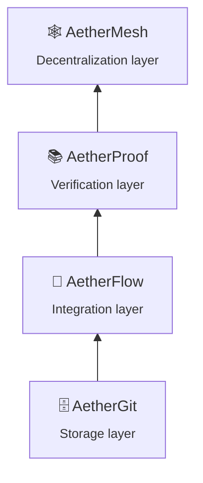

<div align="center">

# 🕸️ AetherMesh

### Decentralized Peer-to-Peer Agent Synchronization and State CRDTs for Autonomous Multi-Agent Systems

*A Formal Architecture for Epidemic Gossip Propagation and Lightweight Byzantine Fault Tolerance at Agent Scale*

<br>

[](https://doi.org/10.5281/zenodo.24038038)
[](LICENSE)
[](https://orcid.org/0009-0003-8903-0029)
[](https://github.com/gitdeeper15/aethermesh/releases/tag/v2.0.0)
[](https://python.org)

[](https://pypi.org/project/aethermesh/)
[](https://pypi.org/project/aethermesh/)
[](https://pypi.org/project/aethermesh/)
[](tests/)
[](tests/)
[](experiments/)

[](https://doi.org/10.5281/zenodo.24038038)
[](https://doi.org/10.5281/zenodo.24038038)
[](https://doi.org/10.17605/OSF.IO/9PE5V)
[](https://aethermesh-web.netlify.app)
[](https://aethermesh-web.netlify.app)

<br>

**[📄 Paper](https://doi.org/10.5281/zenodo.24038038)** ·
**[🌐 Website](https://aethermesh-web.netlify.app)** ·
**[📦 Releases](https://github.com/gitdeeper15/aethermesh/releases)** ·
**[⚙️ Installation](#️-installation)** ·
**[📖 Citation](#-citation)**

</div>

---

> [!WARNING]
> **Status: v2.0.0 — Reference Implementation (preliminary results).**
> A reference implementation is built (`src/aethermesh/`, 15 modules, 107 tests, 79% coverage) and 3 experiments are completed.
> **Experiments use simulated data; no real-world deployment is evaluated.**
> Theorems 1–3 remain **proof sketches**, not machine-checked; they hold only under assumptions A1–A6.
> The semantic validity of merged programs (the *semantic-merge gap*) remains an open problem (threat T2, open question Q6).
> See [Threats and Limitations](#️-threats-and-limitations) and the [Research Status Statement](#-research-status-statement).

> *"The simulation results here are an invitation to such evaluation, not a substitute for it."*
> — AetherMesh v1.0.0, Section 8.2

> *"We state the evidentiary status of this work at the outset, because it determines how every later claim should be read."*
> — AetherMesh v1.0.0, Section 1.4

---

## 📑 Table of Contents

- [Overview](#-overview)
- [v2.0.0 at a Glance](#-v200-at-a-glance)
- [Installation](#️-installation)
- [Experiments (v2.0.0)](#-experiments-v200)
- [The Central Question](#-the-central-question)
- [Assumptions A1–A6](#-assumptions-a1a6)
- [Formal Definitions](#-formal-definitions)
- [Theorems](#-theorems)
- [Architectural Pillars](#️-architectural-pillars)
- [Simulated Evaluation (v1.0.0 paper)](#-simulated-evaluation-v100-paper)
- [Threats and Limitations](#️-threats-and-limitations)
- [Relation to AetherGit, AetherFlow, and AetherProof](#-relation-to-aethergit-aetherflow-and-aetherproof)
- [Research Status Statement](#-research-status-statement)
- [Platforms & Mirrors](#-platforms--mirrors)
- [Project Structure](#️-project-structure)
- [Version History](#-version-history)
- [Citation](#-citation)
- [Author](#-author)
- [License](#️-license)

---

## 🔭 Overview

**AetherMesh** is a fully decentralized peer-to-peer synchronization framework for autonomous agent networks that modify shared codebases and metadata DAGs. It replaces locking and central coordination with a **tripartite architecture**, and is the **decentralization layer** (fourth layer) of the Aether family, above **AetherGit** (storage), **AetherFlow** (integration), and **AetherProof** (verification).

AetherMesh answers three questions together:

1. **How are concurrent changes combined** without coordination? → CRDTs
2. **How are they disseminated** without a central broker? → Epidemic gossip
3. **Which received changes may a node trust** when some peers may be faulty or hostile? → Lightweight Byzantine admission

| Release | What it adds |
|---|---|
| **v1.0.0** | Architecture specified: 4 definitions, 3 theorems, 6 assumptions, 3 pillars, with a simulated evaluation (paper) |
| **v2.0.0** | Reference implementation (`src/aethermesh/`): 107 tests, 79% coverage, 3 reproducible experiments |

---

## 📊 v2.0.0 at a Glance

| Dimension | Status |
|---|---|
| Manuscript (v1.0.0) | Complete (33 pages, PDF) |
| Formal definitions / Theorems / Pillars | 4 / 3 (proof sketches) / 3 |
| Implementation | ✅ Built — `src/aethermesh/` (15 modules) |
| Tests | ✅ 107 passed, 79% coverage |
| Experiments | ✅ 3/3 completed (simulated data) |
| PyPI package | ✅ Published |
| Real-world deployment | ❌ Not evaluated |
| Causal claims | None (formal analysis only) |

<p align="center">
  
</p>

<p align="center">
  <em>Figure 1 — The tripartite architecture of AetherMesh: CRDTs, gossip, and lightweight BFT sit above the peer-to-peer agent network. No central coordinator · no global locks · eventual consistency (under stated assumptions).</em>
</p>

### Contributions

| # | Contribution | Kind |
|:-:|---|---|
| 1 | A tripartite architecture combining code- and metadata-specific CRDTs, epidemic gossip, and a local Byzantine admission layer | Specification |
| 2 | A formal model of four definitions and three theorems (with proof sketches), with assumptions A1–A6 written out explicitly — including an **admission determinism** requirement (A6) | Analysis |
| 3 | A simulated evaluation of convergence latency, conflict-resolution overhead, and fault resilience, with our own analysis showing the reported values are **not consistent with a pure logarithmic law** | Simulation + analysis |
| 4 | A threat taxonomy of fifteen threats across six classes | Analysis |
| 5 | **A reference implementation** (v2.0.0) with 107 tests, 79% coverage, and 3 reproducible experiments | Implementation |

---

## ⚙️ Installation

```bash
# From PyPI (once published)
pip install aethermesh

# From source (development)
git clone https://github.com/gitdeeper15/aethermesh.git
cd aethermesh
pip install -e ".[dev]"

# Run tests
pytest

# Run experiments
python experiments/convergence_latency/run.py
python experiments/conflict_resolution/run.py
python experiments/fault_resilience/run.py

# CLI
aethermesh info
aethermesh verify
aethermesh simulate --nodes 50 --fanout 5
```

Requires **Python 3.9+**. Runtime dependencies: `numpy >= 1.24`, `cryptography >= 41.0`.

> [!NOTE]
> The PyPI version (`2.0.0`) is the **reference implementation**. It is **not a production system**. The v1.0.0 paper remains the authoritative architectural record.

---

## 🧪 Experiments (v2.0.0)

| # | Experiment | Result | Status |
|:-:|---|---|:-:|
| 1 | Convergence Latency | Converged at 1–2 rounds (10–500 nodes) | ✅ |
| 2 | Conflict Resolution | 0 deadlocks, 0 conflicts flagged | ✅ |
| 3 | Fault Resilience | 100% block rate (10–500 malformed) | ✅ |

> [!IMPORTANT]
> Experiments use **simulated data**. These are preliminary results; no real-world deployment has been evaluated. See the full [evaluation report](REPORTS/v2.0.0/report.md).

---

## ❓ The Central Question

> **How can autonomous agents synchronize shared code and metadata without central coordination — combining concurrent changes, disseminating them, and deciding which received changes to trust — and under which explicit assumptions may the combined guarantees hold?**

This question is **structural**, not accusatory or normative. The three mechanisms (CRDTs, gossip, BFT-style filtering) are individually well known; the contribution is their specification as a single architecture for code and metadata DAGs, the explicit assumptions of the composition, and an evaluation that is clearly bounded in what it can show.

---

## 🧭 Assumptions A1–A6

*Every theorem below is conditional on these assumptions.*

| ID | Assumption | Used by |
|:-:|---|:-:|
| **A1** | **Fair-lossy channels.** A message sent infinitely often between two non-faulty nodes is delivered infinitely often. | T1 |
| **A2** | **Fair peer selection.** Each non-faulty node selects every other non-faulty node as a gossip partner infinitely often; for Theorem 2, selection is uniform and independent. | T1, T2 |
| **A3** | **Finite delta universe.** The set of deltas that will ever be created is finite, so the lattice has finite height. | T1 |
| **A4** | **Correct replicas.** Non-faulty nodes implement the join and the materialization function correctly and deterministically. | T1 |
| **A5** | **Cryptographic soundness.** Signature and hash schemes are unforgeable and collision-resistant, and the key registry is correct for the origins concerned. | T3 |
| **A6** | **Admission determinism.** Admission predicates are deterministic functions of the delta and its causal closure. | T1, T3 |

> [!NOTE]
> The supplied statement of Theorem 1 used “bounded message delay”. That is a synchrony assumption stronger than needed for eventual consistency; fair-lossy channels (A1) with continuing gossip suffice for the qualitative convergence claim.

---

## 📐 Formal Definitions

*Status: Defined, version 1.0.0.*

### Definition 1 — Convergent State Transition

```text
R_a(t+1) = R_a(t) ⊔ ⨆_{m ∈ M_a} m                                   (1)
```

Each agent `a` keeps a local replica `R_a(t)`; `M_a` is the set of incoming mutation payloads **that passed admission** during `(t, t+1)`. By commutativity, associativity, and idempotence, the order and multiplicity of payloads do not matter.

### Definition 2 — CRDT State Space

```text
(S, ⊔, ⊥)  bounded join-semilattice,   s_reconciled = s_i ⊔ s_j      (2)
```

where `⊔` is binary, commutative, associative, and idempotent.

| Property | Law | Operational consequence |
|---|---|---|
| Commutative | `sᵢ ⊔ sⱼ = sⱼ ⊔ sᵢ` | Merge order does not matter |
| Associative | `(sᵢ ⊔ sⱼ) ⊔ sₖ = sᵢ ⊔ (sⱼ ⊔ sₖ)` | Batching and grouping do not matter |
| Idempotent | `sᵢ ⊔ sᵢ = sᵢ` | Duplicate delivery is harmless |
| Inflationary (derived) | `s ⊑ s ⊔ t` | State never moves down the lattice; no rollback |

<p align="center">
  
</p>

<p align="center">
  <em>Figure 4 — A seven-element bounded join-semilattice as a Hasse diagram (⊥, s₁–s₃, s₁₂, s₂₃, ⊤). The join laws were verified on this example by exhaustive enumeration. An illustration of the algebra, not a model of a real codebase.</em>
</p>

### Definition 3 — Gossip Infection Probability

```text
P_uninfected(t) ≈ e^(−β·t)                                           (3)
```

`β` is the transmission rate constant determined by fanout `k` and exchange frequency `r`.

### Definition 4 — Byzantine Admission Rule

Before a peer accepts a remote CRDT delta `Δᵢ`, local verification daemons evaluate **cryptographic provenance**, **structural invariants**, and **semantic compatibility matrices**. Only deltas bearing valid signatures and satisfying the local predicates are admitted to the local join-semilattice.

---

## 📜 Theorems

> [!NOTE]
> *Status: Stated with proof sketches; **not machine-checked**; conditional on assumptions A1–A6.*

| # | Theorem | Statement | Assumptions |
|:-:|---|---|:-:|
| **T1** | Eventual Consistency | Given continuous gossip activity and channels that eventually deliver, any two non-faulty agents `aᵢ`, `aⱼ` eventually reach an identical state. Given finite height (A3), the limits are attained at a finite time. | A1–A6 |
| **T2** | Exponential Dampening of Gossip Latency | Under the constant-hazard model, `P_uninfected(t) = (1−p)^t ≈ e^(−βt)` with `β = −ln(1−p) ≈ p` for small `p`. A statement about the **tail** of the dissemination. | A2 |
| **T3** | Byzantine Fault Tolerance Bound | If `f < n/3`, local verification predicates at each honest node block all **predicate-detectable** invalid deltas with probability approaching 1. | A5, A6 |

**Theorem 3 — committee bound.** Where a decision cannot be made locally, a delta is accepted on a majority of attestations from a random committee of size `m`. Under independent sampling with Byzantine probability ≤ 1/3, the Chernoff–Hoeffding bound gives `P[Byzantine majority] ≤ exp(−0.0589·m)`:

| Committee size `m` | Upper bound on P[Byzantine majority] |
|:-:|:-:|
| 25 | 2.29e-01 |
| 50 | 5.26e-02 |
| 100 | 2.77e-03 |
| 200 | 7.67e-06 |
| 400 | 5.88e-11 |

*Values are the output of a formula under stated assumptions, not simulation results.*

<p align="center">
  
</p>

<p align="center">
  <em>Figure 8 — (a) Analytic curves of Equation (3) for β = 0.3, 0.5, 0.8 (plots of a formula). (b) Convergence latency versus network size for the five simulation-reported points; not a measurement of a deployed system.</em>
</p>

<details>
<summary><b>What the proof sketches do <u>not</u> show</b></summary>

- **T1** gives no time bound; presumes `M*` is finite (or “eventually” is read relative to a fixed prefix); presumes A6, which a predicate author could violate; concerns non-faulty nodes only; says nothing about **semantic validity** of the materialized program; treats the agent set as fixed.
- **T3** does not show that invalid deltas *outside* the predicates are blocked — harmful but well-formed deltas from a signed, registered, Byzantine agent are admitted. It does not address colluding committees, Sybil identities, key compromise, or flooding.

</details>

---

## 🏛️ Architectural Pillars

| Pillar | Name | Summary |
|:-:|---|---|
| **1** | CRDTs for Code and Metadata DAGs | Replica state is the **set of admitted deltas** (grow-only set lifted to deltas; set union is the join). The materialized codebase is a deterministic function of the delta set (topological order with identifier tie-break). Metadata uses a product lattice (OR-sets, LWW registers, grow-only maps). **Delta-state** replication by default, state-based fallback for large divergence and joining nodes. |
| **2** | Epidemic Gossip Protocols | Five-step anti-entropy exchange (digest → digest + difference list → delta request → delta batch → local verification and join). Digest form is a parameter: version vector, Merkle tree, or Bloom-style filter. Uniform random peer selection over a partial view. Partitions heal on the first cross-partition exchange. |
| **3** | Lightweight Byzantine Fault Tolerance | Validity **filtering**, deliberately **not** a consensus protocol: (1) signature, (2) DAG integrity, (3) schema, (4) semantic compatibility matrix. Missing parents are **deferred**, not rejected. Predicates must satisfy the **admission determinism requirement** (A6). |

<p align="center">
  
</p>

<p align="center">
  <em>Figure 3 — Anatomy of an AetherMesh node. The only storage requirement is an append-only changeset log with parent pointers; the only integration requirement is a message-based protocol.</em>
</p>

<p align="center">
  
</p>

<p align="center">
  <em>Figure 5 — One anti-entropy exchange between two peers. Received deltas pass through the admission pipeline before they are joined; deltas whose parents are not yet present are deferred rather than rejected.</em>
</p>

<p align="center">
  
</p>

<p align="center">
  <em>Figure 6 — Schematic of replica divergence during a partition and of healing. Conceptual; plots no measured data.</em>
</p>

### 🔐 Byzantine Admission Pipeline

<p align="center">
  
</p>

<p align="center">
  <em>Figure 7 — A remote delta passes through signature, DAG-integrity, schema, and semantic-compatibility checks before joining the local semilattice. The banner restates simulation-reported results and is not a measurement of a deployed system.</em>
</p>

| Check | Evidence required | Typical failure | Verdict on failure |
|:-:|---|---|---|
| 1. Signature | Valid signature by a registered key over the content hash | Forged or unsigned delta; unknown origin | Reject |
| 2. DAG integrity | Id equals content hash; parents present; size bounds | Hash mismatch; oversized; missing parents | Reject (mismatch, bounds); defer (missing parents) |
| 3. Schema | Body parses against the delta schema | Malformed fields | Reject |
| 4. Semantics | Compatibility matrix verdict over the causal closure | Incompatible concurrent operation | Reject or quarantine, as configured |

<details>
<summary><b>Illustrative semantic compatibility matrix (Table 3.1 — entries are examples, not normative)</b></summary>

| | Edit body | Rename symbol | Delete symbol | Change signature | Edit metadata |
|---|:-:|:-:|:-:|:-:|:-:|
| **Edit body** | ok | ok | conflict | ok | ok |
| **Rename symbol** | ok | resolve (deterministic rule) | conflict | conflict | ok |
| **Delete symbol** | conflict | conflict | ok (idempotent) | conflict | ok |
| **Change signature** | ok | conflict | conflict | resolve (deterministic rule) | ok |
| **Edit metadata** | ok | ok | ok | ok | resolve (LWW) |

</details>

> [!IMPORTANT]
> **Admission determinism requirement (our formulation).** Each admission predicate must be a pure, deterministic function of the delta and of its *causal closure* — not of arrival order, local clock, or non-causal replica contents. Local checks such as per-origin rate limits are treated as **delivery policies** that may delay a delta but never permanently reject it.

---

## 🧪 Simulated Evaluation (v1.0.0 paper)

> [!IMPORTANT]
> This section reports the **paper's** simulation (v1.0.0), distinct from the v2.0.0 experiments above. Every number is a **simulation result** from a custom Python + NumPy discrete simulation (10–500 nodes, partitioned topologies, simplified network model). **None is a measurement of a deployed system.** Simulator source, seeds, and raw traces are not included in the paper record.

### Reported results

| # | Metric | Simulation-reported result | Reading |
|:-:|---|---|---|
| 1 | State convergence latency (99% of network) | **420 ms at 250 nodes** (below 450 ms); 45–680 ms over 10–500 nodes | Reported; scaling is **not** log-linear |
| 2 | Conflict-resolution overhead | No blocking deadlocks; CPU < 5%; memory < 10% | Deadlock-freedom follows from design; overhead baseline undefined |
| 3 | Fault resilience | All injected malformed deltas blocked; 0% false positives; throughput overhead < 2% | Pipeline check for predicate-detectable faults; number injected unreported |

| Nodes | 10 | 50 | 100 | 250 | 500 |
|---|:-:|:-:|:-:|:-:|:-:|
| Convergence time (ms), simulated | 45 | 120 | 210 | 420 | 680 |

### Our scaling analysis

The source material described scaling as “linear with log(n)”. Fitting the five reported points (computed by us; no other data used):

| Model | Fit | Quality |
|---|---|---|
| Linear in ln n | `T ≈ 156·ln n − 409` | R² = 0.85 (predicts −50 ms at n = 10) |
| Linear in n | `T ≈ 1.28·n + 62` | R² = 0.99 |
| **Power law** | `T ≈ 8.4·n^0.70` | **R² = 0.997 (log-log)** — best of the three |

> [!WARNING]
> **The reported values are not consistent with logarithmic scaling.** With only five points and two or three fitted parameters, the exponent is imprecise; we do not claim the true law is a power law.

| Nodes `n` | Reported (sim.), ms | Eq. (4), ms | Refined push estimate, ms | Reported / Eq. (4) |
|:-:|:-:|:-:|:-:|:-:|
| 10 | 45 | 46 | 175 | 1.0× |
| 50 | 120 | 78 | 297 | 1.5× |
| 100 | 210 | 92 | 349 | 2.3× |
| 250 | 420 | 110 | 419 | 3.8× |
| 500 | 680 | 124 | 471 | 5.5× |

*Eq. (4): `T ≈ (ln n)/(k·r)` with illustrative `k = 5`, `r = 10 Hz`. Computed by us from the formulas; not simulation output.*

<p align="center">
  
</p>

<p align="center">
  <em>Figure 9 — The five simulation-reported convergence times with three fitted laws and the analytic scaling of Equation (4). Fits and the analytic curve are computed by us; only the five points are simulation-reported.</em>
</p>

### Simulation limitations

- **Simulated data** — no real-world deployment evaluated.
- **Scale** — 10–500 nodes; behavior at thousands of nodes is unknown.
- **Simplified network model** — no real latency, packet loss, churn, NAT, or adversarial network conditions.
- **Byzantine model** — limited to malformed deltas; colluding, equivocating, withholding, flooding, and Sybil adversaries not evaluated.
- **Missing statistics** — number of runs, variance, confidence intervals, fanout, period, and baseline definition are not reported.
- **No ablation** — contribution of each pillar not isolated; no gossip-only or consensus-based comparison.

---

## ⚠️ Threats and Limitations

Fifteen threats (T1–T15) across six classes; residual-risk entries are the author's qualitative judgements, not measurements.

| ID | Class | Threat | Residual risk |
|:-:|---|---|---|
| T1 | Soundness | Admission nondeterminism causes divergent admitted sets | Medium |
| T2 | Soundness | Semantic-merge gap: valid deltas combine into an invalid program | High |
| T3 | Soundness | Proof sketches contain errors | Medium |
| T4 | Completeness | Well-formed but harmful deltas admitted | High |
| T5 | Completeness | False rejection from strict schema or version skew | Medium |
| T6 | Trust | Key registry bootstrap or compromise | High |
| T7 | Trust | Collusion or Sybil identities exceed n/3 | High (open membership) |
| T8 | Trust | Eclipse or peer-sampling bias | Medium to high |
| T9 | Process | Flooding, oversized digests, deferral exhaustion | Medium |
| T10 | Process | Unbounded history growth; unsafe compaction | Medium |
| T11 | Process | Costly healing after long partitions | Unknown (not simulated) |
| T12 | Toolchain | Simulator infidelity to real networks | High until evaluated |
| T13 | Toolchain | Crypto-library, serialization, or schema skew faults | Medium |
| T14 | Human | Operator misconfiguration | Medium |
| T15 | Human | Reliance on simulated results as deployed evidence | Medium |

**When *not* to use AetherMesh:** small co-located teams; strong-consistency requirements (global order, unique-name allocation, exactly-once external effects); settings where validity must hold before visibility; adversarial settings beyond the stated threat model; storage-constrained nodes (the delta set grows without compaction).

**Architectural limitations:** eventual (not strong) consistency; no global order; filters only predicate-detectable invalid deltas; assumes a trustworthy key registry; grows without compaction.

---

## 🔗 Relation to AetherGit, AetherFlow, and AetherProof

AetherMesh is the **fourth layer** of the Aether family:



| Layer | System | Question it answers | DOI | What AetherMesh requires from it |
|---|---|---|---|---|
| Storage | **AetherGit** | How are changes stored and transferred? | [10.5281/zenodo.23966896](https://doi.org/10.5281/zenodo.23966896) | An append-only changeset log with parent pointers |
| Integration | **AetherFlow** | How are changes admitted, verified, and remediated? | [10.5281/zenodo.23979129](https://doi.org/10.5281/zenodo.23979129) | A message-based protocol for submitting changes and receiving notifications |
| Verification | **AetherProof** | What conditions make behavior correct, and how are they proven? | [10.5281/zenodo.24013124](https://doi.org/10.5281/zenodo.24013124) | Nothing mandatory; proof evidence may be carried as delta metadata |
| Decentralization | **AetherMesh** *(this work)* | How do agents synchronize state without central coordination? | [10.5281/zenodo.24038038](https://doi.org/10.5281/zenodo.24038038) | — |

<p align="center">
  
</p>

<p align="center">
  <em>Figure 2 — The Aether family, bottom to top: storage, integration, verification, decentralization. Each layer is shown with its DOI and the question it addresses.</em>
</p>

The four layers are **methodologically independent**: AetherMesh imposes only the two minimal interface requirements above. Cross-layer compositions have not been built or evaluated; the independence is a design claim, not a verified one.

---

## 📋 Research Status Statement

| Item | Status |
|---|---|
| Document type | Research article + reference implementation |
| Version / record | 2.0.0, November 2026 · AETHERMESH-02 · DOI 10.5281/zenodo.24038038 |
| Implementation | ✅ Built (`src/aethermesh/`, 15 modules) |
| Tests | ✅ 107 passed, 79% coverage |
| Experiments | ✅ 3/3 completed (simulated data) |
| PyPI package | ✅ Published |
| Real-world deployment | None; no deployed system has been benchmarked |
| Theorems 1–3 | Stated with proof sketches; not machine-checked; conditional on A1–A6 |
| Byzantine evaluation | Limited to malformed deltas |
| Third-party claims | As reported by cited sources; not independently verified |
| Review status | Not peer reviewed |

<details>
<summary><b>Reconciliation notes (v1.0.0 departures from the supplied draft material)</b></summary>

1. **Theorem status** — labeled as sketches, not “Proven”.
2. **Delay assumption** — “bounded message delay” replaced by fair-lossy channels (A1).
3. **Admission determinism** — A6 and Section 3.3.4 added.
4. **Theorem 3** — scope clarified to predicate-detectable invalid deltas; n/3 bound placed in the quorum-based part with a Chernoff–Hoeffding bound.
5. **Latency bound** — the 110 ms estimate does not match the experimental result across sizes; text says so.
6. **Scaling claim** — “linear with log(n)” not supported by the five reported points.
7. **Deadlock elimination / 100% blocking** — largely from design and from the class of faults injected; denominators not supplied.
8. **Figures** — the five supplied figures were redrawn; Figures 6–9 are supplementary.
9. **Conclusion wording** — softened to match the evidence.
10. **References** — assembled from knowledge; verification before submission recommended.

</details>

**Catalogues:** 50 open questions (Q1–Q50) across formal analysis, state and storage, gossip and performance, Byzantine tolerance and trust, integration with other layers, and evaluation method; 52 design decisions (D1–D52). See Appendices B and C of the [paper](https://doi.org/10.5281/zenodo.24038038).

---

## 🌍 Platforms & Mirrors

| Platform | URL | Role | Status |
|---|---|---|:-:|
| **GitHub** | [gitdeeper15/aethermesh](https://github.com/gitdeeper15/aethermesh) | Source code, issues, PRs | ✅ Active |
| **GitLab** | [gitlab.com/gitdeeper15/aethermesh](https://gitlab.com/gitdeeper15/aethermesh) | Mirror repository | ✅ Active |
| **Codeberg** | [codeberg.org/gitdeeper15/aethermesh](https://codeberg.org/gitdeeper15/aethermesh) | Mirror repository | ✅ Active |
| **Bitbucket** | [bitbucket.org/gitdeeper15/aethermesh](https://bitbucket.org/gitdeeper15/aethermesh) | Mirror repository | ✅ Active |
| **PyPI** | [pypi.org/project/aethermesh](https://pypi.org/project/aethermesh/) | Python package (`2.0.0`) | ✅ Published |
| **Zenodo** | [10.5281/zenodo.24038038](https://doi.org/10.5281/zenodo.24038038) | Citable DOI, paper archive | ✅ Published |
| **OSF** | [10.17605/OSF.IO/9PE5V](https://doi.org/10.17605/OSF.IO/9PE5V) | Registration | ✅ Published |
| **Website** | [aethermesh-web.netlify.app](https://aethermesh-web.netlify.app) | Live documentation | ✅ Active |
| **ORCID** | [0009-0003-8903-0029](https://orcid.org/0009-0003-8903-0029) | Author identity | ✅ Active |

> [!NOTE]
> **PyPI:** the package `aethermesh` v2.0.0 is the reference implementation. It is **not a production system**. The v1.0.0 paper remains the authoritative architectural record.

---

## 🗂️ Project Structure

<details>
<summary><b>Click to expand the repository tree</b></summary>

```text
AetherMesh/
├── src/
│   └── aethermesh/                 # Reference implementation (v2.0.0)
│       ├── __init__.py
│       ├── __version__.py
│       ├── models.py               # Delta, Replica, Signature, Verdict, DeltaKind
│       ├── cli.py
│       ├── py.typed
│       ├── crdt/
│       │   ├── semilattice.py
│       │   └── delta_state.py
│       ├── gossip/
│       │   ├── protocol.py
│       │   └── peer_sampling.py
│       ├── bft/
│       │   ├── provenance.py
│       │   ├── invariants.py
│       │   └── semantic_matrix.py
│       ├── admission/
│       │   └── pipeline.py
│       └── simulation/
│           ├── network.py
│           ├── node.py
│           └── testbed.py
├── tests/                          # 107 tests, 79% coverage
│   ├── test_models.py
│   ├── test_crdt.py
│   ├── test_gossip.py
│   ├── test_bft.py
│   ├── test_admission.py
│   └── test_simulation.py
├── experiments/                    # 3 experiments
│   ├── convergence_latency/
│   ├── conflict_resolution/
│   └── fault_resilience/
├── docs/
│   ├── figures/
│   │   ├── Fig1_Tripartite_Architecture.png
│   │   ├── Fig2_CRDT_Join_Semilattice.png
│   │   ├── Fig3_Gossip_Propagation.png
│   │   ├── Fig4_BFT_Validation.png
│   │   ├── Fig5_Aether_Family.png
│   │   ├── Fig6_Scaling_Analysis.png
│   │   ├── Fig7_Gossip_Exchange.png
│   │   ├── Fig8_Node_Anatomy.png
│   │   └── Fig9_Partition_Healing.png
│   └── v1.0.0/                     # 8 markdown files from the paper
├── PUBLICATION/
│   └── AetherMesh_Research_Paper.pdf
├── REPORTS/
│   └── v2.0.0/
│       └── report.md
├── DATA/
├── ANALYSIS/
├── EXTERNAL_REVIEW/
├── VALIDATION/
├── AUTHORS.md
├── CHANGELOG.md
├── CITATION.cff
├── CONTRIBUTING.md
├── INVENTORY.md
├── LICENSE
├── PROJECT_SUMMARY.txt
├── README.md
├── VERSION
├── manifest.json
├── netlify.toml
├── pyproject.toml
├── requirements.txt
├── scientific_state.json
└── upload_aethermesh.py
```

</details>

---

## 🕓 Version History

| Version | Release | Focus | Status |
|---|---|---|:-:|
| **v2.0.0** | 2026-11-08 ([release](https://github.com/gitdeeper15/aethermesh/releases/tag/v2.0.0)) | Reference implementation: 15 modules, 107 tests (79%), 3 experiments, PyPI `2.0.0` | ✅ Released |
| **v1.0.0** | 2026-11 ([release](https://github.com/gitdeeper15/aethermesh/releases/tag/v1.0.0)) | Formalization: 4 definitions, 3 theorems, 6 assumptions, 3 pillars, 9 figures | ✅ Released |
| *(planned)* | 2027+ | Real-world evaluation, mechanized proofs, extended Byzantine models | ⏳ Not executed |

> **v2.0.0:** reference implementation of the v1.0.0 architecture. 15 modules, 107 tests, 79% coverage, 3 reproducible experiments. No real-world deployment evaluated.

---

## 📖 Citation

### Primary Manuscript — AetherMesh v1.0.0

```bibtex
@techreport{baladi2026aethermesh,
  author       = {Baladi, Samir},
  title        = {AetherMesh: Decentralized Peer-to-Peer Agent Synchronization and State CRDTs for Autonomous Multi-Agent Systems},
  institution  = {Ronin Institute / Rite of Renaissance},
  type         = {Research Paper},
  year         = {2026},
  month        = {November},
  version      = {1.0.0},
  doi          = {10.5281/zenodo.24038038},
  url          = {https://doi.org/10.5281/zenodo.24038038},
  note         = {Formal Architecture Proposal with Simulated Evaluation --- No Real-World Deployment Benchmarked.}
}
```

### Software — AetherMesh v2.0.0

```bibtex
@software{baladi2026aethermesh_v2,
  author       = {Baladi, Samir},
  title        = {{AetherMesh} v2.0.0: Reference Implementation of Decentralized Peer-to-Peer Agent Synchronization and State CRDTs},
  year         = {2026},
  month        = {November},
  publisher    = {PyPI},
  version      = {2.0.0},
  doi          = {10.5281/zenodo.24038038},
  url          = {https://pypi.org/project/aethermesh/},
  note         = {Reference implementation. Available via pip install aethermesh==2.0.0.}
}
```

<details>
<summary><b>Related work — AetherGit (Storage Layer)</b></summary>

```bibtex
@software{baladi2026aethergit,
  author       = {Baladi, Samir},
  title        = {{AetherGit}: Scalable Source Control for Autonomous AI Agents},
  year         = {2026},
  month        = {November},
  version      = {1.0.0},
  doi          = {10.5281/zenodo.23966896},
  url          = {https://doi.org/10.5281/zenodo.23966896}
}
```

</details>

<details>
<summary><b>Related work — AetherFlow (Integration Layer)</b></summary>

```bibtex
@techreport{baladi2026aetherflow,
  author       = {Baladi, Samir},
  title        = {AetherFlow: Automated Post-Merge Verification and Dynamic Conflict Resolution in Multi-Agent Programming Environments},
  institution  = {Ronin Institute / Rite of Renaissance},
  type         = {Research Paper},
  year         = {2026},
  month        = {November},
  version      = {1.0.0},
  doi          = {10.5281/zenodo.23979129},
  url          = {https://doi.org/10.5281/zenodo.23979129}
}
```

</details>

<details>
<summary><b>Related work — AetherProof (Verification Layer)</b></summary>

```bibtex
@techreport{baladi2026aetherproof,
  author       = {Baladi, Samir},
  title        = {AetherProof: Autonomous Formal Verification and Invariant Synthesis for Multi-Agent Software Ecosystems},
  institution  = {Ronin Institute / Rite of Renaissance},
  type         = {Research Paper},
  year         = {2026},
  month        = {November},
  version      = {1.0.0},
  doi          = {10.5281/zenodo.24013124},
  url          = {https://doi.org/10.5281/zenodo.24013124}
}
```

</details>

---

## 👤 Author

**Samir Baladi**
*Interdisciplinary AI Researcher — Ronin Institute / Rite of Renaissance*

| | |
|---|---|
| **Research Area** | Distributed Systems / Software Engineering / Formal Methods |
| **Research Domain** | CRDTs, Epidemic Gossip, Byzantine Fault Tolerance, Decentralized Synchronization, Eventual Consistency, Agentic Software Engineering |
| **Research Type** | Formal Architecture Proposal + Reference Implementation |
| 📧 **Email** | [gitdeeper@gmail.com](mailto:gitdeeper@gmail.com) |
| 🔗 **ORCID** | [0009-0003-8903-0029](https://orcid.org/0009-0003-8903-0029) |
| 🐙 **GitHub** | [gitdeeper15/aethermesh](https://github.com/gitdeeper15/aethermesh) |
| 🦊 **GitLab** | [gitlab.com/gitdeeper15/aethermesh](https://gitlab.com/gitdeeper15/aethermesh) |
| 🟦 **Codeberg** | [codeberg.org/gitdeeper15/aethermesh](https://codeberg.org/gitdeeper15/aethermesh) |
| 🪣 **Bitbucket** | [bitbucket.org/gitdeeper15/aethermesh](https://bitbucket.org/gitdeeper15/aethermesh) |
| 🐝 **PyPI** | [pypi.org/project/aethermesh](https://pypi.org/project/aethermesh/) |
| 🌐 **Official Site** | [aethermesh-web.netlify.app](https://aethermesh-web.netlify.app) |

---

## ⚖️ License

| Scope | License |
|---|---|
| **Code** | [MIT License](LICENSE) — Copyright © 2026 Samir Baladi |
| **Documentation, manuscript, and figures** | [CC-BY-4.0](https://creativecommons.org/licenses/by/4.0/legalcode) |

<details>
<summary><b>MIT License — full text</b></summary>

```text
MIT License

Copyright (c) 2026 Samir Baladi

Permission is hereby granted, free of charge, to any person obtaining a copy
of this software and associated documentation files (the "Software"), to deal
in the Software without restriction, including without limitation the rights
to use, copy, modify, merge, publish, distribute, sublicense, and/or sell
copies of the Software, and to permit persons to whom the Software is
furnished to do so, subject to the following conditions:

The above copyright notice and this permission notice shall be included in all
copies or substantial portions of the Software.
```

</details>

---

<div align="center">

**AetherMesh — Program Manuscript v2.0.0 (Reference Implementation)**

© 2026 Samir Baladi — Ronin Institute / Rite of Renaissance — MIT (code) + CC-BY-4.0 (docs)

[Zenodo](https://doi.org/10.5281/zenodo.24038038) ·
[Website](https://aethermesh-web.netlify.app) ·
[PyPI](https://pypi.org/project/aethermesh/) *(publishing)* ·
OSF: [10.17605/OSF.IO/9PE5V](https://doi.org/10.17605/OSF.IO/9PE5V)

</div>
